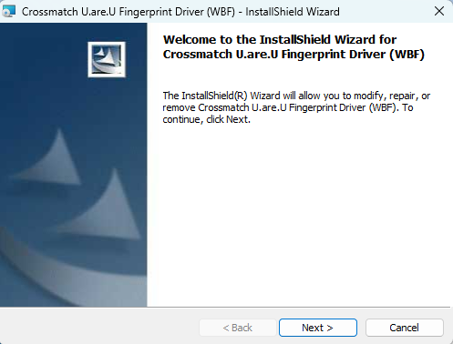
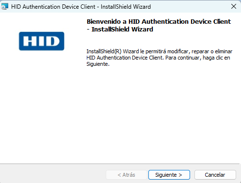
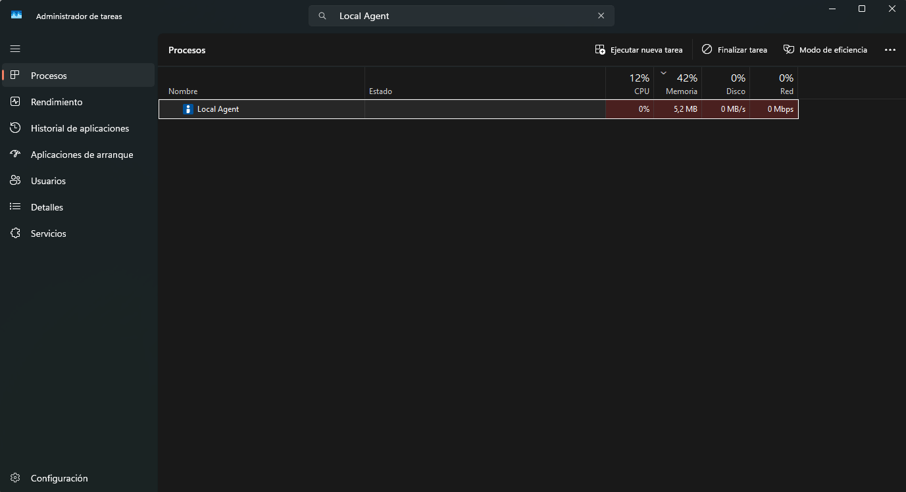
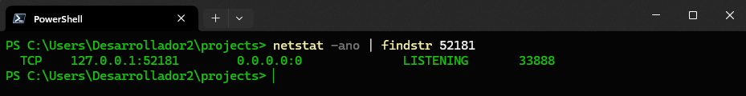
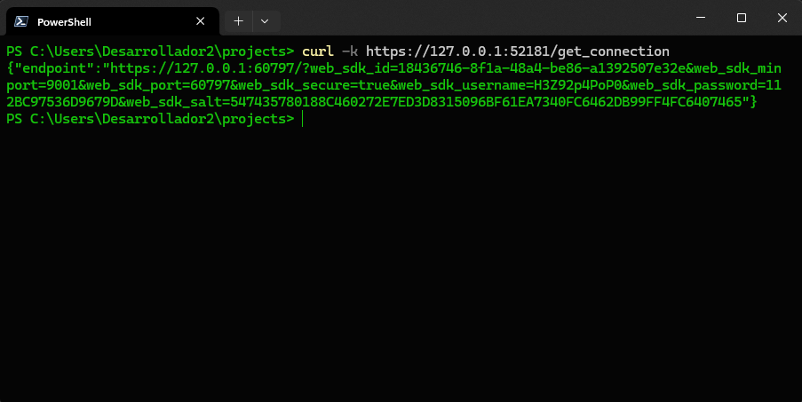
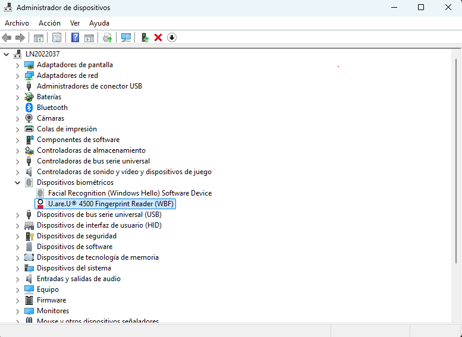

# Guía de Instalación - Biométrico Digital Persona U.are.U 4500

## **📋 Introducción**

El biométrico Digital Persona U.are.U 4500 es un lector de huellas dactilares que permite integrar funcionalidades de autenticación biométrica en aplicaciones web. Esta guía proporciona instrucciones detalladas para su instalación y configuración.

---

## **🖥️ Requisitos del Sistema**

### **⚙️ Requisitos Mínimos:**

- Sistema operativo: Windows 7 o superior
- .NET Framework 4.5 o superior
- Navegador web compatible (Chrome, Firefox, Edge)
- Puerto USB disponible
- Permisos de administrador para la instalación

### **⭐ Requisitos Recomendados:**

- Windows 10 o superior
- .NET Framework 4.8
- Navegador web actualizado con soporte HTTPS

---

## 🔧 **Proceso de Instalación**

### 🚀 **Paso 1: Preparación del Sistema**

> ⚠️ Importante: Asegúrese de tener permisos de administrador y cierre todas las aplicaciones que puedan interferir con el proceso.
> 

---

### 📦 **Paso 2: Instalación del Driver**

El driver es fundamental para el reconocimiento y funcionamiento básico del lector biométrico.

📥 **Descarga e instalación:**

1. Visite el sitio oficial: [https://www.hidglobal.com/drivers/39477](https://www.hidglobal.com/drivers/39477)
2. Descargue la versión más reciente del driver para Digital Persona U.are.U 4500
3. Ejecute el archivo de instalación como administrador
4. Siga las instrucciones del asistente de instalación



**⚙️ Configuración del Driver:**

1. Complete todos los pasos del asistente de instalación
2. Acepte los términos de licencia
3. Elija la ruta de instalación (se recomienda la ruta predeterminada)

> 💡 **María usa el driver WBF** (DigitalPersona 4500 WBF Driver). Con él María se entera al instante de que el lector se desconectó y puede reconectarlo desde el botón «Reconectar». Con el driver WBF el lector aparece en el Administrador de dispositivos bajo **Dispositivos biométricos** (Paso 8). Si en el equipo también está instalado el driver Legacy (U.are.U 4.1.x), Windows puede asignarle ese al lector: el lector queda en otra categoría (por ejemplo «Authentication Devices») y hay que cambiarle el driver por el WBF.

---

### 🔄 **Paso 3: Reinicio del Equipo**

> 💡 Importante: Es necesario reiniciar el equipo para que los drivers se instalen correctamente.
> 

- 🔄 **Reinicie su equipo** después de completar la instalación del driver
- ⏳ Espere a que el sistema se inicie completamente antes de continuar

---

### 🌐 **Paso 4: Instalación de HID Authentication Device Client**

El HID Authentication Device Client es el componente que permite la integración con aplicaciones web.

📥 **Descarga:**

1. Acceda a: [https://crossmatch.hid.gl/lite-client](https://crossmatch.hid.gl/lite-client)
2. Descargue el paquete HID Authentication Device Client más reciente
3. Consulte la documentación oficial: [https://docs.hidglobal.com/digitalpersona-v4.2.0/ad/deploy/install-lite-client.htm](https://docs.hidglobal.com/digitalpersona-v4.2.0/ad/deploy/install-lite-client.htm)

### 🔧 **Instalación:**

1. **Ejecute el instalador como administrador** (botón derecho → "Ejecutar como administrador")
2. Seleccione el idioma de instalación
3. Acepte los términos de licencia
4. Elija la ruta de instalación (se recomienda la ruta predeterminada)
5. Seleccione los componentes a instalar
6. Complete la instalación siguiendo las instrucciones



---

### 🔍 **Paso 5: Verificación de Servicios**

> 💡 Importante: Es crucial verificar que todos los servicios estén ejecutándose correctamente.
> 

🎯 **Verificación en el Administrador de Tareas:**

- ⌨️ Presione **Ctrl + Shift + Esc** para abrir el Administrador de tareas
- 📋 Vaya a la pestaña **"Procesos"**
- 🔍 Busque **"Local Agent"** en la lista de procesos
- ✅ Confirme que el proceso **"Local Agent"** esté en ejecución



---

### 🛠️ **Paso 6: Verificación del Servidor Local**

El servicio debe estar ejecutándose en el puerto **52181** para permitir la comunicación con aplicaciones web.

#### **🔍 Verificar que el puerto esté en escucha:**

1. ⌨️ Presione **Windows + X** y seleccione **"Windows PowerShell (Administrador)"**
2. 💻 Ejecute el siguiente comando:

```powershell
netstat -ano | findstr 52181
```

3. ✅ Verifique que el estado sea **"LISTENING"**



#### **🌐 Verificar que el servidor responda:**

1. En la misma ventana de PowerShell, ejecute:

```powershell
curl -k https://127.0.0.1:52181/get_connection
```

2. ✅ El servidor debe responder con una conexión exitosa



---

### 🔌 **Paso 7: Conexión del Biométrico**

1. 🔌 **Conecte el lector biométrico** Digital Persona U.are.U 4500 a un puerto USB disponible
2. ⏳ Espere a que Windows reconozca automáticamente el dispositivo
3. 🔔 Verifique que aparezca una notificación de dispositivo conectado

---

### ✅ **Paso 8: Verificación del Dispositivo**

🎯 **Verificación en el Administrador de Dispositivos:**

1. ⌨️ Presione **Windows + R**
2. 💻 Escriba **"devmgmt.msc"** y presione Enter
3. 🔍 Busque la categoría **Dispositivos biométricos**
4. ✅ Confirme que el dispositivo **Digital Persona U.are.U 4500** esté reconocido sin errores



> ⚠️ Si el equipo es un portátil con lector de huella propio, ese sensor también aparece en **Dispositivos biométricos** y el agente lo lista como un lector más. María prefiere el U.are.U (es óptico), pero si hay problemas, deshabilite el sensor del portátil: clic derecho > **Deshabilitar dispositivo**.

---

### ⚡ **Paso 9: Ajustes para que la conexión sea estable**

Estos ajustes evitan que el lector se desconecte a ratos.

**🔌 Conexión física:** conecte el lector **directamente** a un puerto USB del equipo, sin concentradores (hubs) sin fuente propia, bases (docks) ni puertos del monitor.

**🔋 Ahorro de energía USB:** Windows puede apagar el puerto USB del lector para ahorrar energía.

1. Desactive la **suspensión selectiva de USB** del plan de energía: Panel de control > Opciones de energía > **Cambiar la configuración del plan** > **Cambiar la configuración avanzada de energía** > Configuración de USB > **Configuración de suspensión selectiva de USB** > **Deshabilitado**, con batería y con corriente.

   Si la opción no aparece (pasa en muchos portátiles con Windows 11), ejecute en PowerShell como administrador:

   ```powershell
   powercfg /SETACVALUEINDEX SCHEME_CURRENT 2a737441-1930-4402-8d77-b2bebba308a3 48e6b7a6-50f5-4782-a5d4-53bb8f07e226 0
   powercfg /SETDCVALUEINDEX SCHEME_CURRENT 2a737441-1930-4402-8d77-b2bebba308a3 48e6b7a6-50f5-4782-a5d4-53bb8f07e226 0
   powercfg /SETACTIVE SCHEME_CURRENT
   ```

2. En el Administrador de dispositivos, abra las **Propiedades** del lector y de los **Concentradores raíz USB**. Si tienen la pestaña **Administración de energía**, desmarque **Permitir que el equipo apague este dispositivo para ahorrar energía**.

**🌐 Permiso del navegador:** desde Chrome 142, una página de internet necesita permiso para hablar con programas del propio equipo, como el agente del lector. La primera vez que María use el lector, Chrome pregunta: hay que **permitirlo**. Si se negó, haga clic en el candado de la barra de direcciones de María > **Configuración del sitio** y ponga en **Permitir** el permiso de acceso a la red local o a las apps del dispositivo. En equipos administrados, el área de sistemas puede permitirlo para `https://mariatrazabilidad.com.co` con las políticas de Chrome `LocalNetworkAccessAllowedForUrls` y, desde Chrome 146 en Windows, `LoopbackNetworkAllowedForUrls`.

---

## 🧪 **Pruebas y Verificación**

### 🌐 **Prueba con Repositorio de Ejemplo**

Para verificar que todo funcione correctamente, puede utilizar el siguiente repositorio de prueba:

📥 **Descarga del repositorio:**

1. 🔗 Visite: [https://github.com/shanxp/fingerprint-digital-persona-u-are-u-4500-web-example](https://github.com/shanxp/fingerprint-digital-persona-u-are-u-4500-web-example?tab=readme-ov-file)
2. 📦 Descargue o clone el repositorio
3. 📂 Abra el archivo **index.html** con su navegador web
4. ✍️ Siga las instrucciones para registrar y verificar una huella dactilar

### ✅ **Verificación de Funcionalidades**

**Pruebe las siguientes funciones:**

- 👆 **Captura de huella dactilar**
- 🎯 **Calidad de lectura**
- 📊 **Velocidad de reconocimiento**
- 🌐 **Integración con navegador**

---

## 🩺 **Diagnóstico del Biométrico**

El script [`diagnostico-biometrico.ps1`](diagnostico-biometrico.ps1) revisa el equipo **sin cambiar nada** y deja un informe en el Escritorio. Úselo cuando el biométrico no conecte o falle a ratos, y envíe el informe a soporte.

### ▶️ **Cómo ejecutarlo**

1. 📥 Descargue [`diagnostico-biometrico.ps1`](diagnostico-biometrico.ps1) en el equipo, por ejemplo en **Descargas**.
2. 🛡️ Abra PowerShell **como administrador** (**Windows + X** > **Terminal (Administrador)** o **Windows PowerShell (Administrador)**). Sin administrador también funciona, pero no revisa la energía USB de cada dispositivo ni algunos eventos.
3. 💻 Ejecute:

   ```powershell
   cd $env:USERPROFILE\Downloads
   powershell -ExecutionPolicy Bypass -File .\diagnostico-biometrico.ps1
   ```

4. ✅ Al final muestra un **resumen** y la ruta del informe: `diagnostico-biometrico-<EQUIPO>-<fecha>.txt`, en el Escritorio.

El informe lleva el nombre del equipo, la versión de Windows, los dispositivos, los procesos y los eventos de Windows de los últimos días. No lleva contraseñas: el script consulta al agente, pero solo anota el puerto que anuncia, nunca su usuario ni su clave.

**Opciones:**

| Opción | Uso |
| --- | --- |
| `-Days 7` | Días de eventos de Windows que revisa (7 por defecto) |
| `-MonitorMinutes 480` | En vez del informe, vigila el equipo esos minutos (8 horas = una jornada) y anota con hora cada cambio: lector conectado o no, DPAgent vivo y su puerto, el puerto 52181, el servicio de biometría de Windows y las suspensiones del equipo. Deja `monitor-biometrico-<EQUIPO>-<fecha>.txt` en el Escritorio, escrito a medida que pasa: se puede detener antes con **Ctrl + C** sin perder lo anotado. Sirve para cruzar con la hora en que el usuario reporta la falla |
| `-MonitorSeconds 5` | Cada cuántos segundos revisa en modo vigilancia |
| `-OutDir C:\ruta` | Carpeta donde deja los archivos (el Escritorio por defecto) |

### 🔍 **Qué revisa**

1. El equipo (Windows, usuario, si es administrador)
2. El lector: estado, categoría, driver y versión, y por qué puertos y concentradores USB pasa hasta el equipo
3. Otros sensores de huella (el del portátil)
4. La energía USB: suspensión selectiva y si Windows puede apagar el lector o sus concentradores
5. El servicio de biometría de Windows, el agente (DPAgent), sus versiones y el driver WBF
6. El puerto 52181, la respuesta de `get_connection`, si el agente escucha en el puerto que anuncia y cuántas conexiones de navegadores tiene abiertas
7. Los certificados de `127.0.0.1` / `localhost`
8. Las políticas de biometría y la seguridad de inicio de sesión mejorada
9. Los navegadores y sus políticas de acceso a la red local
10. El antivirus
11. Los eventos de Windows: conexiones y desconexiones del lector, errores de USB y de biometría, cierres inesperados del agente o del driver, suspensiones del equipo

### 📋 **Cómo leer el resumen**

Cada hallazgo viene marcado **[ALTO]** (impide usar el lector), **[MEDIO]** (puede causar fallas a ratos) o **[INFO]**.

| Hallazgo | Qué hacer |
| --- | --- |
| El lector no está conectado | Conéctelo. Si lo está, cambie de puerto o de cable |
| El lector está en la clase '...', no 'Biometric' | Tomó el driver Legacy: cámbielo por el WBF (Paso 2) |
| El lector pasa por un concentrador USB | Conéctelo directo al equipo (Paso 9) |
| Hay otro sensor de huella WBF | Deshabilite el sensor del portátil (Paso 8) |
| Suspensión selectiva de USB / Windows puede apagar para ahorrar energía | Desactívelo (Paso 9) |
| El agente local (DPAgent) no está corriendo / anuncia un puerto donde nadie escucha | Abra `DPAgent.exe` (Problema 1) o reinicie el equipo; en María, pulse **Reconectar** |
| Nadie escucha en el puerto 52181 / get_connection falla | Problemas 2 y 3 |
| Seguridad de inicio de sesión mejorada / NonEssSensorsBlocked | Desactívela (ver «El lector biométrico no es reconocido») |
| El agente o el driver se cerraron inesperadamente | Repare el HID Authentication Device Client (Problema 3) y avise a soporte con el informe |
| El lector se reconectó muchas veces | Cable, puerto, concentrador o ahorro de energía (Paso 9) |
| Hay N conexiones abiertas al agente | Recargue (F5) las pestañas de María abiertas desde hace mucho |
| Chrome 142+ pide permiso | Revise el permiso del navegador (Paso 9) |

### 🖥️ **Mensajes de María**

Cuando no hay biométrico, María muestra debajo de «Biométrico desconectado» el motivo y el botón **Reconectar**. Reconectar descarta la conexión con el agente y la abre de nuevo pidiéndole otra vez su puerto, que cambia cada vez que DPAgent se reinicia (al iniciar sesión, al volver de una suspensión). Ya no hace falta recargar la página. María también reconecta sola si se cae la conexión y al volver a la pestaña.

| Mensaje | Qué hacer |
| --- | --- |
| No se pudo contactar el programa del lector en este equipo | El puerto 52181 no responde o el navegador no deja llegar a él: Pasos 6 y 9, Problemas 2 y 3 |
| El servicio del lector responde, pero su agente (DPAgent) no | Abra `DPAgent.exe` (Problema 1) o reinicie el equipo, y pulse **Reconectar** |
| El programa del lector responde, pero no encuentra ningún lector conectado | Conecte el lector directo al equipo; si está conectado, Paso 8 y el script |
| El lector reportó un error (0x…) | Vuelva a seleccionar el dedo. Si se repite, desconecte y conecte el lector; si sigue, ejecute el script |
| La página no cargó el componente del lector | Recargue la página |

Si después de **Reconectar** sigue sin biométrico, ejecute el script de diagnóstico.

---

## 🔧 **Solución de Problemas**

### 🚨 **Problemas Comunes y Soluciones**

#### ❌ **Problema 1: El "Local Agent" no está disponible en los procesos**

**Descripción:** El proceso "Local Agent" no aparece en el Administrador de tareas.

**Solución:**

1. 📂 Navegue a la ruta: `C:\Program Files\HID Global\Authentication Device Client\Bin`
2. 🖱️ Busque el archivo **DPAgent.exe**
3. 🖱️ Haga **clic derecho** y seleccione **"Ejecutar como administrador"**
4. ✅ Verifique en el Administrador de tareas que el proceso "Local Agent" esté activo
5. 🔄 En María, pulse **Reconectar**: el agente arrancó en otro puerto y María lo vuelve a pedir

---

#### ⚠️ **Problema 2: El servidor no responde al comando curl**

**Descripción:** Al ejecutar `curl -k https://127.0.0.1:52181/get_connection` en PowerShell, el servicio no responde.

**Solución:**

1. ⌨️ Abra el **Administrador de tareas** (Ctrl + Shift + Esc)
2. 🔍 Busque el proceso **"Local Agent"**
3. 🖱️ Haga **clic derecho** y seleccione **"Finalizar tarea"**
4. 📂 Navegue a: `C:\Program Files\HID Global\Authentication Device Client\Bin`
5. 🖱️ Ejecute el archivo **DPAgent.exe** como administrador
6. ⏳ Espere unos segundos y vuelva a probar el comando curl
7. 🔄 En María, pulse **Reconectar**

---

#### 🔧 **Problema 3: El puerto 52181 no está en estado LISTENING**

**Descripción:** Al ejecutar `netstat -ano | findstr 52181`, el servicio no está disponible o no aparece en estado LISTENING.

**Solución:**

1. ⌨️ Presione **Windows + R**
2. 💻 Escriba **"appwiz.cpl"** y presione Enter
3. 🔍 Busque **"HID Authentication Device Client"** en la lista
4. 🖱️ Haga **clic derecho** y seleccione **"Cambiar"** o **"Modificar"**
5. 🔧 Seleccione la opción **"Reparar"**
6. ⏳ Espere a que finalice el proceso de reparación
7. 🔄 Reinicie el equipo si es necesario
8. ✅ Verifique nuevamente con el comando netstat

---

#### 🚨 **El lector biométrico no es reconocido:**

**Solución:**

- Verifique que el cable USB esté conectado correctamente
- Pruebe con un puerto USB diferente (preferiblemente USB 2.0 o superior)
- Reinstale el driver del dispositivo
- Verifique en el Administrador de dispositivos si hay conflictos o errores
- Desactive la **seguridad de inicio de sesión mejorada** (Windows 11). Mientras está activa, Windows bloquea los lectores de huella externos que no son compatibles con ella, como el U.are.U 4500 con el driver WBF:
  1. Vaya a **Configuración** > **Cuentas** > **Opciones de inicio de sesión** > **Configuración adicional**
  2. Ponga **Seguridad de inicio de sesión mejorada** en **Desactivado**. En Windows 11 23H2 el interruptor se llama **Iniciar sesión con una cámara externa o lector de huellas digitales**: póngalo en **Activado**
  3. Si el lector sigue sin aparecer, reinicie el equipo

  Al desactivarla, Windows borra las huellas y los rostros de Windows Hello registrados con ella y las llaves de acceso (passkeys) asociadas; se pueden registrar de nuevo. Si el interruptor no aparece, puede que la organización lo bloquee por política. El script de diagnóstico dice si Windows está bloqueando el lector (`NonEssSensorsBlocked`).

  > ⚠️ Versiones anteriores de esta guía pedían ejecutar `reg add "HKLM\Software\Microsoft\Windows NT\CurrentVersion\Virtualization" /v "EnableEnhancedSessionMode" ...`. Ese valor es de Hyper-V (sesiones mejoradas de máquinas virtuales) y no tiene nada que ver con el lector: no lo use.
- Ejecute el [script de diagnóstico](#-diagnóstico-del-biométrico)

---

#### 🔁 **El biométrico funciona a ratos**

**Descripción:** a veces conecta y a veces no, o se desconecta en medio de una captura.

**Solución:**

1. Revise los ajustes del **Paso 9**: conexión directa, ahorro de energía USB y permiso del navegador
2. Ejecute el [script de diagnóstico](#-diagnóstico-del-biométrico) y atienda los hallazgos [ALTO] y [MEDIO]
3. Si no aparece la causa, deje el script vigilando una jornada (`-MonitorMinutes 480`) y anote la hora de cada falla: el archivo del monitor muestra qué cambió en ese momento (el lector, el agente, una suspensión del equipo...)


---

#### 🔐 **Problemas de permisos:**

**Solución:**

- Ejecute el navegador como administrador
- Verifique que el usuario tenga permisos para acceder al dispositivo
- Agregue excepciones en el firewall para el puerto 52181
- Verifique que el antivirus no esté bloqueando el servicio

---

## 📚 **Recursos y Enlaces Importantes**

### 🔗 **Enlaces de Descarga**

| Recurso | Enlace |
| --- | --- |
| 📦 **Driver Digital Persona** | [https://www.hidglobal.com/drivers/39477](https://www.hidglobal.com/drivers/39477) |
| 🌐 **HID Authentication Device Client** | [https://crossmatch.hid.gl/lite-client](https://crossmatch.hid.gl/lite-client) |
| 📚 **Documentación oficial** | [https://docs.hidglobal.com/digitalpersona-v4.2.0/ad/deploy/install-lite-client.htm](https://docs.hidglobal.com/digitalpersona-v4.2.0/ad/deploy/install-lite-client.htm) |
| 🧪 **Repositorio de prueba** | [https://github.com/shanxp/fingerprint-digital-persona-u-are-u-4500-web-example](https://github.com/shanxp/fingerprint-digital-persona-u-are-u-4500-web-example?tab=readme-ov-file) |
| 🩺 **Script de diagnóstico** | [diagnostico-biometrico.ps1](diagnostico-biometrico.ps1) |

### 💻 **Comandos Útiles**

| Comando | Función |
| --- | --- |
| `Windows + R` → `devmgmt.msc` | 🔧 Abrir Administrador de dispositivos |
| `Windows + R` → `appwiz.cpl` | 📦 Abrir Programas y características |
| `netstat -ano \| findstr 52181` | 🔍 Verificar puerto del servicio |
| `curl -k https://127.0.0.1:52181/get_connection` | 🌐 Probar conexión con el servicio |
| `powershell -ExecutionPolicy Bypass -File .\diagnostico-biometrico.ps1` | 🩺 Diagnóstico completo del biométrico (informe en el Escritorio) |

### 📂 **Rutas Importantes**

| Ruta | Descripción |
| --- | --- |
| `C:\Program Files\HID Global\Authentication Device Client\Bin` | 📁 Ubicación del ejecutable DPAgent.exe |

---

## 📝 **Notas Finales**

- 🔒 El servicio utiliza **HTTPS** en el puerto **52181** para garantizar comunicaciones seguras
- 🔄 Si experimenta problemas persistentes, considere desinstalar completamente ambos componentes y realizar una instalación limpia
- 💡 Mantenga siempre actualizado el software del fabricante para obtener las últimas mejoras de seguridad y rendimiento
- 📧 Para soporte adicional, consulte la documentación oficial de HID Global

---

**✅ Instalación completada exitosamente**

Si ha seguido todos los pasos correctamente, su lector biométrico Digital Persona U.are.U 4500 debería estar completamente funcional y listo para integrarse con sus aplicaciones web.

