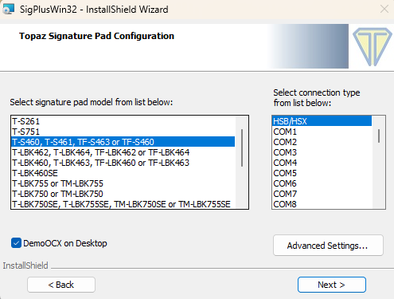

# Guía de Instalación - Tablet Topaz T-S460-HSB-R (María 2.0)

> ⚠️ **Esta guía es para María 2.0.** María 1.0 usaba SigWeb y tiene su propia guía: [Tablet Topaz T-S460-HSB-R (María 1.0)](../Tablet%20Topaz%20T-S460-HSB-R/README.md). En María 2.0 **no se usa SigWeb**.

## **📋 Introducción**

La tablet Topaz T-S460-HSB-R captura la firma manuscrita de vendedores, compradores y colaboradores en María 2.0. Para que María pueda usarla, el equipo necesita **tres piezas**, en este orden:

| # | Pieza | Qué es | Dónde queda |
| --- | --- | --- | --- |
| 1 | **SigPlus** | Driver de la tablet | Programas instalados de Windows |
| 2 | **SigPlusExtLite** | Programa de Topaz que habla con la tablet | `C:\Windows\SigPlus\SigPlusExtLite\Chrome\Topaz.SigPlusExtLite.exe` |
| 3 | **Extensión de Chrome** "Topaz SigPlusExtLite Extension" | Puente entre María y el programa | `chrome://extensions` |

Cómo viaja la firma: **María → extensión de Chrome → programa SigPlusExtLite → tablet**.

> 💡 A diferencia de SigWeb (María 1.0), SigPlusExtLite **no es un servicio de Windows ni usa un puerto ni internet**: Chrome abre el programa cuando se va a firmar. Por eso no hay nada que buscar en `services.msc` y el firewall no interviene.

---

## **🖥️ Requisitos del Sistema**

- Windows 10 o superior (32 o 64 bits)
- .NET Framework 4.8 o superior
- **Google Chrome** 88 o superior
- Puerto USB disponible
- Permisos de administrador para la instalación

> ⚠️ Firefox no sirve para firmar con Topaz en María 2.0: María carga el componente de la extensión de Chrome.

---

## 🔧 **Proceso de Instalación**

### 🚀 **Paso 1: Preparación del Sistema**

> ⚠️ Importante: Asegúrese de tener permisos de administrador y cierre las aplicaciones que puedan interferir con el proceso.

- Si el equipo tiene una versión anterior de **SigPlusExtLite**, desinstálela primero (`Windows + R` → `appwiz.cpl`). Topaz lo pide antes de instalar una nueva.
- **SigWeb no es necesario** para María 2.0. Si el equipo ya no usa María 1.0, puede desinstalarse.

### 📦 **Paso 2: Instalación del Driver SigPlus**

El driver SigPlus es el que permite que Windows reconozca la tablet. Topaz pide la versión 4.4.0.24 o superior. **Si ya está instalado (por ejemplo, porque el equipo usaba María 1.0), no hace falta reinstalarlo.**

📥 **Descarga e instalación:**

1. Descargue el instalador oficial: [https://www.topazsystems.com/software/sigplus.exe](https://www.topazsystems.com/software/sigplus.exe)
2. Haga clic derecho sobre el archivo → **"Ejecutar como administrador"**
3. Siga las instrucciones del asistente de instalación:

    1️⃣ **Selección del modelo:** seleccione **"T-S460, T-S461, TF-S463 or TF-S460"**

    2️⃣ **Tipo de conexión:** seleccione **"HSB/HSX"**

    

4. Conecte la tablet al puerto USB cuando se le solicite y espere a que Windows la reconozca.

---

### 🌐 **Paso 3: Instalación de SigPlusExtLite**

SigPlusExtLite es el programa de Topaz que se comunica con la tablet. **Sin él, el botón Topaz de María se queda cargando y no abre la ventana de firma.**

📥 **Descarga:**

1. Página oficial (versiones y guías): [https://www.topazsystems.com/sdks/sigplusextlite.html](https://www.topazsystems.com/sdks/sigplusextlite.html)
2. Instalador: [https://www.topazsystems.com/software/SigPlusExtLite_V3.exe](https://www.topazsystems.com/software/SigPlusExtLite_V3.exe)
3. Guía oficial de instalación (inglés): [SigPlusExtLite_V3_UserInstall.pdf](https://www.topazsystems.com/software/SigPlusExtLite_V3_UserInstall.pdf)

> ⚠️ No confundir con **SigWeb** ni con **SigPlus**: el instalador correcto se llama **SigPlusExtLite**.

### 🔧 **Instalación:**

1. **Ejecute el instalador como administrador** (clic derecho → "Ejecutar como administrador")
2. Siga los pasos del asistente con las opciones predeterminadas
3. Al terminar, confirme que existe el archivo `C:\Windows\SigPlus\SigPlusExtLite\Chrome\Topaz.SigPlusExtLite.exe` (ver [Verificación de la Instalación](#-verificación-de-la-instalación))

---

### 🧩 **Paso 4: Instalación de la Extensión de Chrome**

1. Abra Google Chrome y entre a la página de la extensión en la Chrome Web Store: [Topaz SigPlusExtLite Extension](https://chrome.google.com/webstore/detail/topaz-sigplusextlite-back/dhcpobccjkdnmibckgpejmbpmpembgco)
2. Haga clic en **"Agregar a Chrome"** (Add to Chrome)
3. En la ventana de confirmación, haga clic en **"Agregar extensión"** (Add extension)
4. Entre a `chrome://extensions` y confirme que **"Topaz SigPlusExtLite Extension"** aparece **activada**
5. Entre a `chrome://settings/system` y active **"Seguir ejecutando aplicaciones en segundo plano al cerrar Google Chrome"** (Continue running background apps when Google Chrome is closed), como pide Topaz

> 💡 Con esa opción activa, cerrar las ventanas **no** cierra Chrome. Para cerrarlo por completo use el ícono de Chrome junto al reloj de Windows → **"Salir"**, o el menú ⋮ de Chrome → **"Salir"**.

### 🔄 **Paso 5: Reiniciar Chrome**

1. Cierre Chrome **por completo** (ícono junto al reloj → "Salir")
2. Ábralo de nuevo y entre a María 2.0

---

## 🔍 **Verificación de la Instalación**

### 📁 **El programa SigPlusExtLite está instalado**

En el Explorador de archivos, abra `C:\Windows\SigPlus\SigPlusExtLite\Chrome` y confirme que está el archivo **`Topaz.SigPlusExtLite.exe`**.

Para una revisión completa (registro de Chrome + archivo), abra **PowerShell** y pegue:

```powershell
foreach ($k in 'HKLM:\SOFTWARE\WOW6432Node','HKLM:\SOFTWARE','HKCU:\SOFTWARE') { foreach ($h in 'com.topaz.sigplusextlite.win.2','com.topaz.sigplusextlite.win') {
  $m = (Get-ItemProperty "$k\Google\Chrome\NativeMessagingHosts\$h" -ErrorAction SilentlyContinue).'(default)'
  if (-not $m) { continue }
  $exe = if (Test-Path $m) { $p = (Get-Content $m -Raw | ConvertFrom-Json).path; if ([IO.Path]::IsPathRooted($p)) { $p } else { Join-Path (Split-Path $m) $p } }
  "$h -> programa: $exe -> existe: $(if ($exe) { Test-Path $exe } else { 'falta el manifest' })"
} }
```

| Resultado | Qué significa |
| --- | --- |
| `com.topaz.sigplusextlite.win.2 -> programa: C:\WINDOWS\SigPlus\SigPlusExtLite\Chrome\Topaz.SigPlusExtLite.exe -> existe: True` | ✅ Instalado correctamente |
| No imprime nada | ❌ SigPlusExtLite no está instalado: haga el [Paso 3](#-paso-3-instalación-de-sigplusextlite) |
| `existe: False` o `falta el manifest` | ❌ Estuvo instalado y falta el programa (lo borró el antivirus o una desinstalación): reinstale el Paso 3 y revise el antivirus |

### 🧩 **La extensión está activa**

- Entre a `chrome://extensions`
- ✅ **"Topaz SigPlusExtLite Extension"** debe aparecer **activada**, sin errores

### 🎯 **El proceso aparece al firmar**

- `Topaz.SigPlusExtLite.exe` aparece en el Administrador de tareas (**Ctrl + Shift + Esc**) **solo mientras se usa la tablet**; no es un servicio y no tiene que estar siempre en ejecución.

---

## 🧪 **Pruebas y Verificación**

### 🌐 **Prueba con la Demo de Topaz**

Prueba la tablet sin María: si funciona aquí, el equipo quedó bien instalado.

1. 🔗 Abra en Chrome: [www.sigplusweb.com/SigPlusExtLite/v3/Demo/sign_chrome_ff_sigplusextlite.html](http://www.sigplusweb.com/SigPlusExtLite/v3/Demo/sign_chrome_ff_sigplusextlite.html)
2. 🖱️ Haga clic en **"Sign"**: se abre la ventana de firma de Topaz
3. ✍️ Firme en la tablet
4. ✅ Acepte con el **check verde** (el ícono azul borra y el rojo cancela)

### ✍️ **Prueba en María 2.0**

1. Entre a un documento de **Firma** (por ejemplo, la firma de un vendedor o de una compra) y haga clic en **"Firmar"**
2. En el modal **"Firma"**, haga clic en el botón **"Topaz"**
3. Se abre la ventana de firma de Topaz: firme en la tablet y acepte con el **check verde**
4. La firma aparece en el recuadro del modal: haga clic en **"Guardar"**

---

## 🔧 **Solución de Problemas**

### 🚨 **Problemas Comunes y Soluciones**

⏳ **El botón "Topaz" se queda en "Firmando con Topaz..." y no se abre la ventana de firma:**

Normalmente no aparece ningún error, ni en María ni en la consola del navegador. Revise en este orden:

1. **Ventana escondida:** con **Alt + Tab**, en la barra de tareas o en otro monitor, busque una ventana de firma de Topaz abierta de un intento anterior. Firme o cancele en ella e intente de nuevo.
2. **Demo de Topaz:** pruebe la [demo](#-prueba-con-la-demo-de-topaz). Si tampoco funciona, el problema es del equipo, no de María.
3. **SigPlusExtLite no instalado:** haga la [verificación](#-el-programa-sigplusextlite-está-instalado). Es la causa más común: el equipo tiene SigWeb o solo SigPlus, pero no SigPlusExtLite.
4. **Antivirus** (McAfee u otro): puede borrar, poner en cuarentena o bloquear `Topaz.SigPlusExtLite.exe`.
    - Revise la cuarentena y el historial de seguridad del antivirus; si aparece algo de Topaz o SigPlus, restáurelo.
    - Agregue la carpeta `C:\Windows\SigPlus\` a las exclusiones del antivirus.
    - En antivirus corporativos (McAfee/Trellix administrado), las reglas "Exploit Prevention" o "Access Protection" pueden impedir que Chrome abra el programa: la excepción la pone el área de sistemas.
5. **Reinicio completo:** salga de Chrome por completo (ícono junto al reloj → "Salir"), termine `Topaz.SigPlusExtLite` en el Administrador de tareas si aparece, desconecte y conecte la tablet, y abra Chrome de nuevo.

🧩 **María dice que SigPlusExtLite o la extensión de Topaz no está instalada o no está habilitada:**

- Entre a `chrome://extensions` y active **"Topaz SigPlusExtLite Extension"** (o instálela, [Paso 4](#-paso-4-instalación-de-la-extensión-de-chrome))
- Recargue la página de María (**F5**)

⚠️ **María dice "Hay una ventana de firma de Topaz abierta de un intento anterior":**

- Busque esa ventana (Alt + Tab, barra de tareas, otro monitor), termine o cancele la firma e intente de nuevo.

🐞 **En la consola del navegador (F12) aparece `Uncaught TypeError: Cannot read properties of undefined (reading 'sendMessage')`:**

- La extensión se actualizó o se reinició mientras María estaba abierta. Recargue la página (**F5**).
- Si sigue saliendo: en `chrome://extensions` desactive y active la extensión, cierre Chrome por completo y ábralo de nuevo.

❌ **La tablet no es reconocida:**

- Verifique que el cable USB esté conectado correctamente
- Pruebe con un puerto USB diferente
- Reinstale el driver SigPlus seleccionando el modelo **T-S460** y la conexión **HSB/HSX** ([Paso 2](#-paso-2-instalación-del-driver-sigplus))
- Verifique en el Administrador de dispositivos si hay conflictos

🔥 **Firewall:**

- En María 2.0 **no hace falta** agregar excepciones en el firewall: la extensión y el programa se comunican dentro del mismo equipo, sin red. (Las excepciones eran para SigWeb en María 1.0.)

---

### 🔎 **Ver los mensajes de la extensión (avanzado)**

Los errores entre la extensión y el programa **no aparecen en la consola de María**, sino en la de la propia extensión:

1. Entre a `chrome://extensions` y active el **"Modo de desarrollador"** (arriba a la derecha)
2. En **"Topaz SigPlusExtLite Extension"**, haga clic en **"service worker"** (Inspeccionar vistas)
3. En la ventana que se abre, vaya a la pestaña **Console**
4. En María, haga clic en **"Topaz"** y lea las líneas que empiezan por `SPEL:`

| Mensaje | Qué significa | Qué hacer |
| --- | --- | --- |
| `Specified native messaging host not found.` | SigPlusExtLite no está instalado | [Paso 3](#-paso-3-instalación-de-sigplusextlite) |
| `Access to the specified native messaging host is forbidden.` | El programa instalado no corresponde a la extensión | Reinstalar SigPlusExtLite |
| `Native host has exited.` | El programa se cerró o falló | Reinstalar SigPlusExtLite y revisar el antivirus |
| `Command: SignatureCapture` y después nada que diga `Sending command to NMH` | La extensión cree que ya hay una ventana de firma abierta | Buscar la ventana escondida o reiniciar Chrome por completo |
| `onNativeMessage: {...}` | El programa sí respondió | Revisar el texto de la respuesta |

Para ver también los mensajes en la consola de María (**F12**), pegue esto, recargue la página (**F5**) y vuelva a hacer clic en **"Topaz"**:

```js
localStorage.setItem('SPEL_WRAPPER_LOGGER_LEVEL', '2'); localStorage.setItem('SPEL_CONTENT_LOGGER_LEVEL', '2')
```

Aparecen líneas `SPEL [Wrapper]` y `SPEL [Content]`. Para apagarlos, use `'0'` en lugar de `'2'`.

---

## 🆚 **Diferencias con María 1.0**

| | María 1.0 | María 2.0 |
| --- | --- | --- |
| Componente web | SigWeb | SigPlusExtLite + extensión de Chrome |
| Driver | SigPlus | SigPlus |
| Servicio de Windows | "Topaz SigWeb Tablet Service" (`services.msc`) | Ninguno: Chrome abre `Topaz.SigPlusExtLite.exe` al firmar |
| Comunicación | Puerto local del equipo | Dentro de Chrome, sin red (native messaging) |
| Firewall | Podía requerir excepciones | No interviene |
| .NET Framework | 4.5+ con características WCF | 4.8+ |
| Demo de prueba | sigwebtablet_demo.htm | sign_chrome_ff_sigplusextlite.html |

---

## 📚 **Recursos y Enlaces Importantes**

### 🔗 **Enlaces de Descarga**

| Recurso | Enlace |
| --- | --- |
| 📦 **SigPlus Driver** | [https://www.topazsystems.com/software/sigplus.exe](https://www.topazsystems.com/software/sigplus.exe) |
| 🌐 **SigPlusExtLite (página oficial)** | [https://www.topazsystems.com/sdks/sigplusextlite.html](https://www.topazsystems.com/sdks/sigplusextlite.html) |
| 💾 **SigPlusExtLite (instalador)** | [https://www.topazsystems.com/software/SigPlusExtLite_V3.exe](https://www.topazsystems.com/software/SigPlusExtLite_V3.exe) |
| 🧩 **Extensión de Chrome** | [Topaz SigPlusExtLite Extension](https://chrome.google.com/webstore/detail/topaz-sigplusextlite-back/dhcpobccjkdnmibckgpejmbpmpembgco) |
| 📚 **Guía oficial de instalación** | [SigPlusExtLite_V3_UserInstall.pdf](https://www.topazsystems.com/software/SigPlusExtLite_V3_UserInstall.pdf) |
| 🧪 **Demo de prueba** | [sign_chrome_ff_sigplusextlite.html](http://www.sigplusweb.com/SigPlusExtLite/v3/Demo/sign_chrome_ff_sigplusextlite.html) |

### 💻 **Comandos Útiles**

| Comando | Función |
| --- | --- |
| `chrome://extensions` | 🧩 Ver y activar la extensión de Topaz |
| `chrome://settings/system` | ⚙️ Ejecución en segundo plano de Chrome |
| `Windows + R` → `appwiz.cpl` | 📦 Programas instalados (SigPlus, SigPlusExtLite) |
| `Ctrl + Shift + Esc` | 🎯 Administrador de tareas (`Topaz.SigPlusExtLite.exe`) |
| `F5` en María | 🔄 Recargar la página después de cambios en la extensión |
